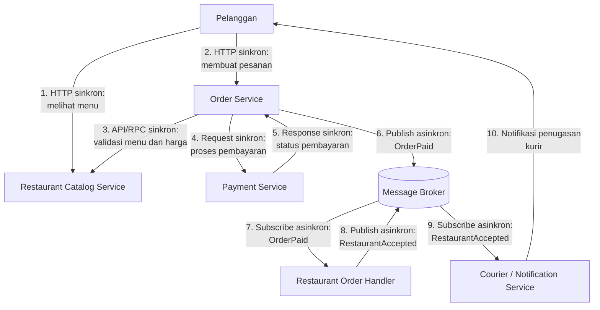

# Jurnal Proses — Tugas 2

## [19 Oktober 2026]
- Opsi arsitektur yang dipertimbangkan: SOA sebagai utama dan Pub Sub sebagai pelengkap
- Kenapa akhirnya pilih [SOA/Pub-Sub]: SOA memisahkan layanan agar dapat diperbarui secara mandiri, sedangkan Pub Sub mengurangi ketergantungan langsung untuk pemberitahuan pesanan.
- Revisi diagram (versi 1 → versi 2, apa yang berubah dan kenapa): ...

## Nomor 1 (Yolanda Elva Angelica - 103072400125)

### 1. Analisis Masalah Monolitik FoodGo

Analisis saat ini adalah semua komponen mulai dari pemesanan, pembayaran, notifikasi kurir hingg katalog resto berjalan di dalam satu server dalam aplikasi, sehingga muncul beberapa masalah seperti:

- Deploy, yaitu perubahan yang terjadi di dalam komponen yang menyebabkan aplikasi tersebut harus memasang ulang seluruh aplikasi baru lagi agar bisa digunakan.

- Downtime, yaitu kondisi dimana aplikasi tidak dapat digunakan sementara sehingga semua komponennya melakukan restart.

- Coupling tinggi, yaitu kondisi dimana bagian bagian komponen saling bergantungan sehingga dapat menyebabkan bug pada komponen lain.

- Skalabilitas yang tidak fleksibel, yaitu misalnya Ketika jam makan siang, komponen yang paling terbebani ialah pesanan tapi yang bisa di scale hanya seluruh aplikasi bukan hanya modul tertentu.

akar masalahnya ialah komponen yang tidak bisa terisolasi yang menyebabkan komponen saling bergantung dan bisa saja menyebabkan bug sewaktu Waktu apalagi Ketika pesanan sedang ramai, maka dari itu dibutuhkan arsitektur yang tiap komponennya terpisah dan juga independen serta di scale sendiri

### 2. Pemilihan Arsitektur

Pemilihan Arsitektur yang kami gunakan adalah Service-Oriented Architecture (SOA) sebagai gaya Utama dan Publsih-Subscribe sebagai pelengkap khusus alur notifikasi. Komponen ini dipecah menjadi server independent yaitu serice pesanan, service pembayaran, service notifikasi kurir, dan service katalog resto. service yang membutuhkan jawaban langsung (pesanan ke pembayaran) berkomunikasi melalui API/RPC. Notifikasi ke kurir dan resto dikirim asinkron melalui message broker.

### 3. Alasan Pemilihan

menggunakan kombinasi SOA dan Pub-Sub, karena kebutuhan FoodGo bukan hanya memisahkan komponen, tetapi juga membuat komunikasi antarkomponen lebih fleksibel. Dalam laporan, jelaskan bahwa pemisahan layanan memungkinkan deployment independen, sedangkan Pub-Sub membantu mengurangi ketergantungan langsung untuk pemberitahuan pesanan.

## Nomor 2 (Difa Auliya Andini Putri - 103072400112)

## Nomor 3 - Alur Skenario End-to-End (Adisty Fatika Ardani - 103072400091)

**Skenario:** pelanggan melihat menu, membuat pesanan, membayar, resto menyetujui pesanan, lalu kurir ditugaskan.

Nomor langkah di bawah sama dengan nomor panah pada diagram di bagian 2.

| No | Dari → Ke | Jenis Komunikasi | Penjelasan |
|----|-----------|------------------|------------|
| 1 | Pelanggan → Restaurant Catalog Service | Sinkron, HTTP request-response | Pelanggan membuka daftar menu dan langsung menerima datanya. |
| 2 | Pelanggan → Order Service | Sinkron, HTTP request-response | Pelanggan mengirim pesanan ke Order Service. |
| 3 | Order Service → Restaurant Catalog Service | Sinkron, API/RPC | Order Service memvalidasi menu dan harga. Hasilnya harus diketahui dulu sebelum lanjut, sehingga sinkron. |
| 4 | Order Service → Payment Service | Sinkron, request | Order Service meminta pembayaran diproses. |
| 5 | Payment Service → Order Service | Sinkron, response | Payment Service mengembalikan status pembayaran. Pesanan hanya dilanjutkan jika pembayaran berhasil. |
| 6 | Order Service → Message Broker | Asinkron, publish event | Setelah pembayaran berhasil, Order Service mempublikasikan event **OrderPaid** tanpa menunggu respons. |
| 7 | Message Broker → Restaurant Order Handler | Asinkron, subscribe event | Broker meneruskan **OrderPaid** ke Restaurant Order Handler, yang menerima dan memproses informasi pesanan baru. |
| 8 | Restaurant Order Handler → Message Broker | Asinkron, publish event | Setelah restoran benar-benar menyetujui pesanan, Restaurant Order Handler menerbitkan event **RestaurantAccepted**. Menerima informasi pesanan belum berarti menyetujuinya. |
| 9 | Message Broker → Courier/Notification Service | Asinkron, subscribe event | Courier/Notification Service menerima **RestaurantAccepted** dan memulai proses penugasan kurir. |
| 10 | Courier/Notification Service → Pelanggan | Notifikasi (push) | Setelah kurir berhasil ditemukan dan penugasan dikonfirmasi, pelanggan diberi tahu bahwa kurir sudah ditugaskan. |

### Komunikasi Sinkron (Langkah 1-5)
Dipakai untuk proses yang butuh jawaban langsung sebelum alur berlanjut, yaitu melihat menu, validasi menu dan harga, serta pembayaran. Pesanan tidak boleh dilanjutkan jika menu tidak valid atau pembayaran gagal.

### Komunikasi Asinkron (Langkah 6-9)
Dipakai setelah pembayaran berhasil, melalui Message Broker dengan pola Pub-Sub. Order Service cukup mempublikasikan event tanpa tahu siapa yang akan menerimanya.

Jika Restaurant Order Handler atau Courier/Notification Service sedang tidak tersedia, Message Broker dapat menyimpan event untuk diproses ketika layanan kembali aktif, asalkan broker dan konsumennya dikonfigurasi untuk mendukung penyimpanan pesan (durable) dan pemrosesan ulang (acknowledgment dan retry). Dengan demikian, gangguan pada satu layanan tidak harus langsung menghentikan layanan lainnya.

### Langkah 10: Notifikasi ke Pelanggan
Langkah 10 adalah kelanjutan proses, yaitu pengiriman notifikasi oleh Courier/Notification Service ke pelanggan. Diagram saat ini belum menunjukkan apakah notifikasi dikirim melalui broker atau langsung oleh service tersebut, sehingga langkah ini tidak dikategorikan sebagai bagian Pub-Sub. Notifikasi hanya dikirim setelah penugasan kurir berhasil dikonfirmasi.

### Kesesuaian dengan Diagram
- **Langkah 1-5:** komunikasi langsung request-response sesuai rancangan SOA (Pelanggan, Order Service, Restaurant Catalog Service, Payment Service).
- **Langkah 6-9:** komunikasi event melalui Message Broker sesuai pola Pub-Sub (Order Service, Restaurant Order Handler, Courier/Notification Service).
- **Langkah 10:** pengiriman notifikasi oleh Courier/Notification Service ke pelanggan.

## Nomor 4 - Analisis Pengurangan Coupling dan Trade-off (Glory Leonthine Angi' - 103072400058)

#### Pengurangan Coupling
Dengan menggabungkan konsep Service Oriented Architecture (SOA) dan Publish Subscribe (Pub Sub), kita bisa membuat antar layanan di FoodGo mengurangi ketergantungan antarlayanan(coupling) dan tugas tiap layanan jadi lebih fokus dan komunikasi langsung antar layanan bisa diminimalkan.

Dari sisi SOA, setiap service mulai dari pesanan, pembayaran, katalog menu, penerimaan pesanan di resto, sampai kurir punya ranah tugasnya masing-masing. Efek positifnya, kita bisa update atau menjalankan service tersebut secara terpisah. Contohnya, pembaruan layanan kurir tidak mengharuskan layanan katalog dan pembayaran ikut restart, selama kontrak API dan format event tidak berubah.

Sementara di sisi Pub Sub, order service menerbitkan event OrderPaid melalui message broker. Order service tidak perlu mengetahui alamat restaurant order handler atau menunggu restoran selesai memproses pesanan. Saat restoran menyetujui pesanan, event RestaurantAccepted akan otomatis diteruskan melalui broker ke courier/notification service.

Meskipun demikian, coupling tidak sepenuhnya hilang. Order service masih berkomunikasi secara sinkron dengan Restaurant Catalog Service untuk memvalidasi menu, serta Payment Service untuk mengetahui status pembayaran.

#### Kelebihan Arsitektur
**1. Pembaruan lebih mandiri.** Layanan kurir dapat diperbarui tanpa membuat seluruh layanan FoodGo ikut restart.
**2. Kapasitas lebih fleksibel.** Kapasitas layanan pesanan dapat ditambah saat ramai tanpa harus menambah kapasitas semua layanan.
**3. Komunikasi lebih fleksibel.** Pengirim event tidak harus menunggu penerima selesai memprosesnya

#### Kekurangan dan Trade off
**1. Pelacakan error lebih rumit.** Alur pesanan melewati beberapa layanan dan broker sehingga sumber masalah lebih sulit ditemukan.
**2. Bergantung pada jaringan dan broker.** Gangguan pada keduanya dapat menghambat komunikasi dan proses pesanan.
**3. Event bisa terlambat atau diterima berulang.** Sistem perlu menangani kondisi ini agar pesanan tidak diproses 2 kali.
**4. Pengelolaan lebih kompleks.** Setiap layanan dan broker membutuhkan konfigurasi serta pemantauan.

### Kesimpulan
Kombinasi SOA dan Publish Subscribe membantu FoodGo mengurangi ketergantungan antarlayanan. SOA memungkinkan layanan diperbarui dan ditambah kapasitasnya secara terpisah, sedangkan Pub Sub mendukung komunikasi event melalui message broker tanpa menunggu penerima selesai memprosesnya. Namun, rancangan ini membutuhkan pemantauan antarlayanan, penanganan kegagalan jaringan dan broker, serta pengelolaan event agar pesanan tidak diproses berulang.

## Log Penggunaan AI (Level 2)

> Wajib diisi sesuai kebijakan Level 2 di [`../RUBRIK-UMUM.md`](../RUBRIK-UMUM.md). Tulis "Tidak memakai AI" pada baris pertama jika memang tidak dipakai. Hanya untuk brainstorming ide/outline — bukan untuk kode/analisis/teks akhir.

| Tanggal | Tool AI | Prompt yang diberikan | Ringkasan saran/ide AI | Bagaimana diolah jadi tulisan/kode sendiri |
|---|---|---|---|---|
| ... | ... | ... | ... | ... |
