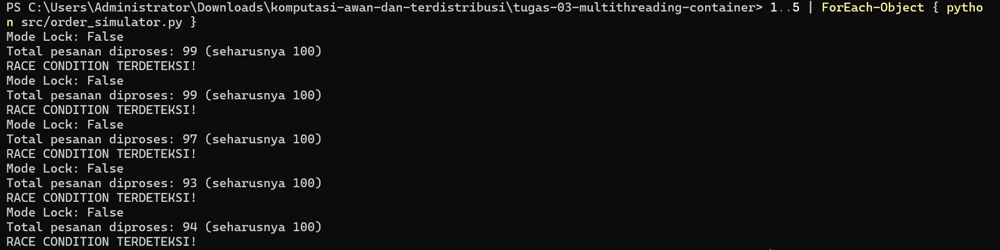
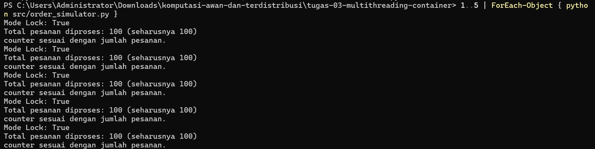

# Jurnal Proses — Tugas 3

## Percobaan tanpa Lock (Jawaban Yolanda)
- Hasil `processed_count` yang didapat: 99, 99, 97, 93, 94 (seharusnya 100).  
- Alasan meleset: Operasi processed_count += 1 sebenarnya terdiri dari tiga langkah, yaitu membaca nilai, menambahkannya, lalu menuliskannya kembali. Tanpa lock, dua thread dapat membaca nilai yang sama sebelum salah satunya menulis, sehingga keduanya menuliskan hasil yang sama dan satu pembaruan hilang. Hal ini terjadi secara acak sesuai penjadwalan thread, sehingga hasilnya berbeda-beda pada setiap percobaan. Pada kode simulasi, increment dipecah menjadi baca, sleep(0), lalu tulis agar race condition muncul konsisten.

## Percobaan dengan Lock (Jawaban Yolanda)
- Hasil `processed_count` setelah perbaikan: 100, 100, 100, 100, 100.  
- Lock memastikan hanya satu thread yang dapat menjalankan blok baca-tambah-tulis pada counter dalam satu waktu, sehingga tidak ada pembaruan yang saling menimpa dan hasilnya selalu konsisten, yaitu 100.

## Kendala Docker
- Error yang ditemui saat `docker build`/`docker run` dan cara memperbaikinya: ...

## Log Penggunaan AI (Level 2)

> Wajib diisi sesuai kebijakan Level 2 di [`../RUBRIK-UMUM.md`](../RUBRIK-UMUM.md). Tulis "Tidak memakai AI" pada baris pertama jika memang tidak dipakai. Hanya untuk brainstorming ide/outline — bukan untuk kode/analisis/teks akhir.

| Tanggal | Tool AI | Prompt yang diberikan | Ringkasan saran/ide AI | Bagaimana diolah jadi tulisan/kode sendiri |
|---|---|---|---|---|
| ... | ... | ... | ... | ... |
