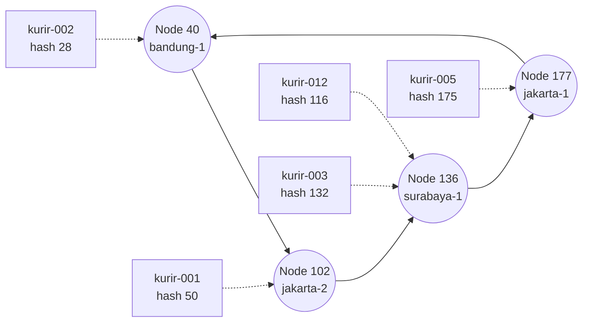
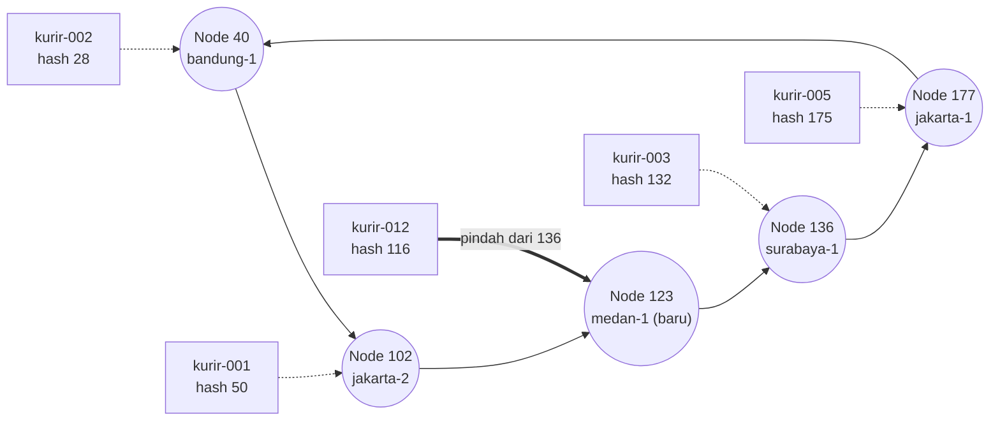
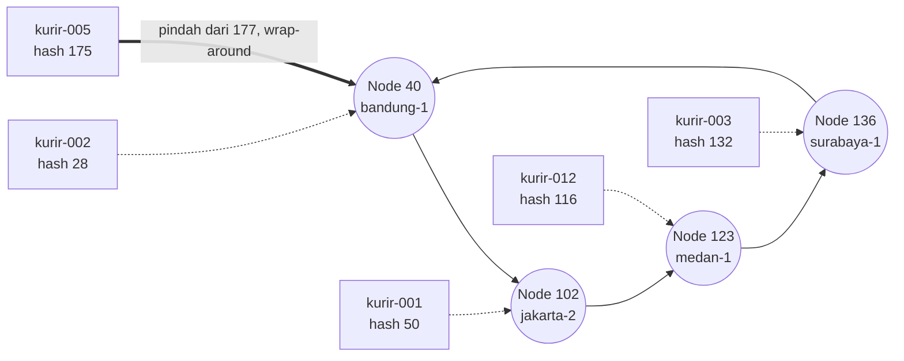

# Tugas 6 (Pekan 6) — Penamaan & Resolusi Lokasi

**Materi terkait:** Flat Naming, Structured Naming (DNS), Distributed Hash Table (DHT)/Chord.

## Studi Kasus

Pelanggan FoodGo kesulitan menemukan alamat IP server kurir yang **dinamis** (kurir berpindah lokasi/jaringan, IP-nya sering berubah). FoodGo butuh cara memetakan **ID Kurir** (identitas tetap) ke **alamat IP terkininya** tanpa server pusat tunggal yang jadi bottleneck/single point of failure.

## Tugas Kelompok

Implementasikan **simulasi Chord DHT** sederhana (single-process, tidak perlu jaringan sungguhan — cukup simulasi struktur data & algoritma di satu program Python) yang memetakan ID Kurir ke alamat IP mereka.

Konsep yang harus terlihat jalan dalam simulasi kalian:
1. **Consistent hashing**: ID Kurir dan ID Node di-hash ke ruang angka yang sama (mis. 0–255 untuk kesederhanaan, `m=8` bit).
2. **Ring topology**: node-node diurutkan melingkar berdasarkan hasil hash-nya.
3. **Lookup**: fungsi `lookup(kurir_id)` yang menemukan node mana yang bertanggung jawab menyimpan mapping ID Kurir tersebut → alamat IP-nya (aturan Chord: node dengan ID hash **terkecil yang lebih besar atau sama dengan** hash key, disebut *successor*).
4. **Perubahan topologi**: simulasikan minimal satu node baru bergabung (`join`) atau satu node keluar (`leave`), tunjukkan bagaimana mapping berpindah tanggung jawab ke node lain.

Skeleton disediakan di `src/chord_simulation.py` dengan fungsi hashing dan struktur ring sudah ada — bagian `lookup()`, `join()`, dan `leave()` sengaja dikosongkan.

### Cara Menjalankan

```bash
python3 src/chord_simulation.py
```

## Tugas Analisis (`README.md`)

1. Jelaskan **kenapa DHT/Chord** lebih cocok untuk kasus ini dibanding **flat naming sederhana** (mis. tabel pusat ID→IP) atau **DNS konvensional** — kaitkan dengan sifat "IP kurir sering berubah" dan kebutuhan tanpa titik gagal tunggal.
**Konteks.** IP server kurir sering berubah, sedangkan ID Kurir tetap. FoodGo membutuhkan pemetaan ID Kurir → IP terkini tanpa server pusat yang menjadi bottleneck atau single point of failure (SPOF).

**Flat naming (tabel pusat ID→IP).** Semua lookup dan update bergantung pada satu server. Karena IP kurir sering berubah, update menumpuk di server itu (bottleneck), dan jika server mati, seluruh pencarian kurir gagal (SPOF).

**DNS konvensional.** Bersifat hierarkis dan dirancang untuk nama yang relatif stabil. Caching dan TTL membuat perubahan IP tidak langsung terlihat, sehingga IP kurir bisa usang. Menurunkan TTL memperberat server authoritative, dan titik hierarki (root/TLD) tetap menjadi titik ketergantungan.

**DHT/Chord.** ID Kurir dan ID Node di-hash ke ruang yang sama dan node tersusun melingkar. Mapping disimpan di *successor* dari hash ID Kurir.
- Saat IP kurir berubah, cukup perbarui entri di satu node penanggung jawab. ID Kurir tetap sehingga lookup selalu mengarah ke node yang sama.
- Tidak ada server pusat, jadi tidak ada SPOF. Jika satu node keluar, hanya key miliknya yang berpindah ke successor-nya.
- Consistent hashing menyebar key dan beban query ke banyak node, sehingga tidak ada bottleneck.

**Perbandingan ringkas.**

| Aspek | Flat Naming | DNS Konvensional | DHT/Chord |
|---|---|---|---|
| Struktur | Satu tabel/server pusat | Hierarkis | Terdistribusi (ring) |
| SPOF | Ya | Sebagian | Tidak ada |
| Bottleneck | Tinggi | Sedang | Rendah |
| Cocok untuk IP sering berubah | Kurang (beban menumpuk) | Kurang (TTL/caching) | Baik |

**Dukungan dari hasil simulasi.** Pada simulasi dengan 4 node (id 40, 102, 136, 177), setiap Courier ID dipetakan ke successor-nya, misalnya kurir-001 (hash=50) ditangani node 102 dan kurir-002 (hash=28) ditangani node 40. Tidak ada server pusat yang menyimpan seluruh tabel. Saat node-medan-1 (id=123) bergabung, hanya kurir-012 (hash=116) yang berpindah dari node 136 ke node 123. Saat node-jakarta-1 (id=177) keluar, hanya kurir-005 (hash=175) yang berpindah ke node 40. Lookup kurir-001 dan kurir-002 tetap mengarah ke node dan IP yang sama sebelum dan sesudah perubahan topologi. Ini menunjukkan bahwa perubahan node hanya memengaruhi sebagian kecil mapping dan sistem tetap berjalan tanpa titik gagal tunggal.

**Kesimpulan.** Chord paling sesuai untuk FoodGo karena menangani identitas tetap dengan lokasi dinamis, tanpa bottleneck dan SPOF.

2. Gambarkan (boleh pakai Mermaid, lihat Tugas 2) ring topology dari simulasi kalian, tandai node mana yang bertanggung jawab atas ID Kurir mana.

## Diagram Topologi Ring Chord
 
Panah solid = successor antar node. Panah putus-putus = pemetaan kurir ke node penanggung jawab. Panah tebal = mapping yang berpindah. Node ber-hash terbesar menunjuk kembali ke node terkecil (wrap-around).
 
### 1. Kondisi Awal (4 node)
 

 
### 2. Setelah Node medan-1 (ID 123) Join
 

 
### 3. Setelah Node jakarta-1 (ID 177) Leave
 

 
### Ringkasan Pemetaan
 
| Kurir | Hash | Awal | Setelah Join | Setelah Leave |
|---|---|---|---|---|
| kurir-002 | 28 | Node 40 | Node 40 | Node 40 |
| kurir-001 | 50 | Node 102 | Node 102 | Node 102 |
| kurir-012 | 116 | Node 136 | **Node 123** | Node 123 |
| kurir-003 | 132 | Node 136 | Node 136 | Node 136 |
| kurir-005 | 175 | Node 177 | Node 177 | **Node 40** |

3. Jelaskan apa yang terjadi pada mapping saat sebuah node **keluar** dari ring (siapa yang mengambil alih tanggung jawabnya) — dukung dengan output program

## Implementasi dan Hasil Pengujian Simulasi Chord DHT
#### Implementasi
Simulasi Chord DHT dibuat menggunakan Python dalam satu proses tanpa jaringan sungguhan. ID node dan ID kurir di-hash menggunakan SHA-1 ke ruang identifier 0–255.

Fungsi yang diimplementasikan:

- `find_successor()`: menentukan node penanggung jawab berdasarkan hash key, termasuk wrap-around.
- `register_kurir()`: menyimpan mapping ID kurir ke alamat IP.
- `lookup()`: mencari dan mengembalikan alamat IP kurir.
- `join()`: menambahkan node dan menampilkan perubahan tanggung jawab mapping.
- `leave()`: menghapus node dan mengalihkan tanggung jawab mapping ke successor berikutnya.

Mapping disimpan dalam dictionary bersama sesuai skeleton. Perpindahan tanggung jawab ditunjukkan melalui log program.

#### Hasil pengujian
| Pengujian | Hasil |
|---|---|
| Lookup awal | `kurir-001` mengembalikan IP `192.168.1.10` melalui node `102`, sedangkan `kurir-002` mengembalikan IP `192.168.1.11` melalui node `40`. |
| Join | Node Medan dengan ID `123` bergabung. Tanggung jawab `kurir-012` dengan hash `116` berpindah dari node `136` ke node `123`. |
| Leave | Node Jakarta dengan ID `177` keluar. Tanggung jawab `kurir-005` dengan hash `175` berpindah ke node `40` melalui wrap-around. |
| Lookup setelah perubahan topologi | `kurir-001` dan `kurir-002` tetap mengembalikan alamat IP yang sesuai. |

#### Kesimpulan
Simulasi berhasil menjalankan lookup serta menunjukkan perubahan tanggung jawab mapping ketika node bergabung dan keluar. Pada pengujian ini, mapping kurir yang tidak terdampak perubahan topologi tetap dapat ditemukan.


## Struktur Submission

```
tugas-06-penamaan-dht/
├── README.md      # Analisis + diagram ring
├── JURNAL.md
├── src/
│   └── chord_simulation.py
└── bukti/          # Output program (screenshot/log) untuk skenario join & leave
```

## Rubrik Penilaian (Tugas 6)

| Komponen | Bobot | Kriteria |
|---|---|---|
| Implementasi lookup/join/leave benar | 35% | Consistent hashing & successor lookup sesuai aturan Chord |
| Bukti perubahan topologi (join/leave) | 25% | Output menunjukkan mapping berpindah dengan benar |
| Analisis kenapa DHT vs flat naming/DNS | 25% | Argumen spesifik ke kasus IP kurir dinamis, bukan definisi umum |
| Proses & kontribusi kelompok | 15% | `JURNAL.md`, commit history |

## Batasan Penggunaan AI (Level 2)

Kebijakan **Level 2 (AI Assisted Idea Generation & Structuring)** berlaku — lihat [`../RUBRIK-UMUM.md`](../RUBRIK-UMUM.md). Boleh bertanya konsep umum consistent hashing/Chord ke AI; **tidak boleh** meminta AI menuliskan isi `# TODO` di `src/chord_simulation.py` (`find_successor`, `join`, `leave`, dst). Catat pemakaian AI di "Log Penggunaan AI" pada `JURNAL.md`.

- `README.md` wajib menelusuri manual (langkah demi langkah) bagaimana `lookup()` menemukan successor untuk salah satu ID Kurir contoh yang dipakai di `chord_simulation.py` — bukan cuma menempelkan output program.
